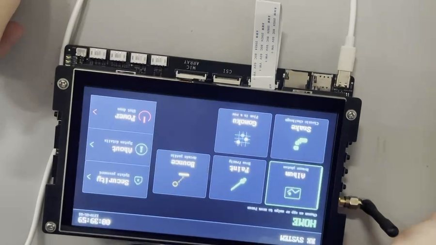
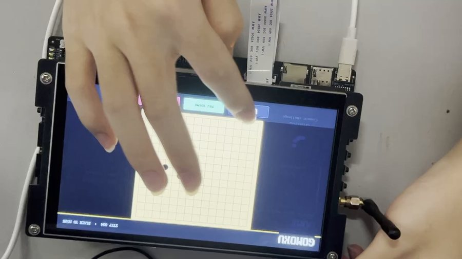
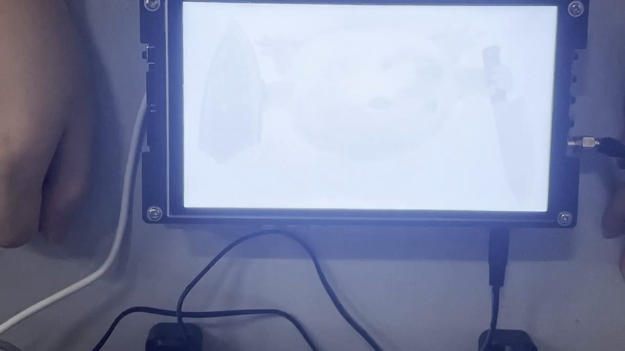
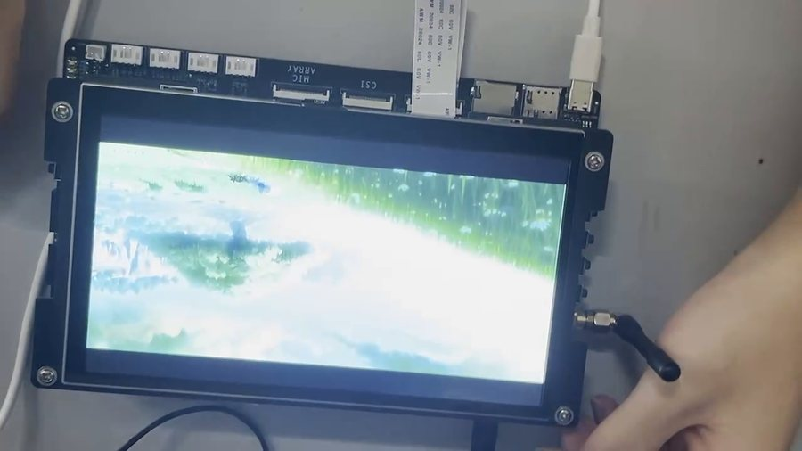
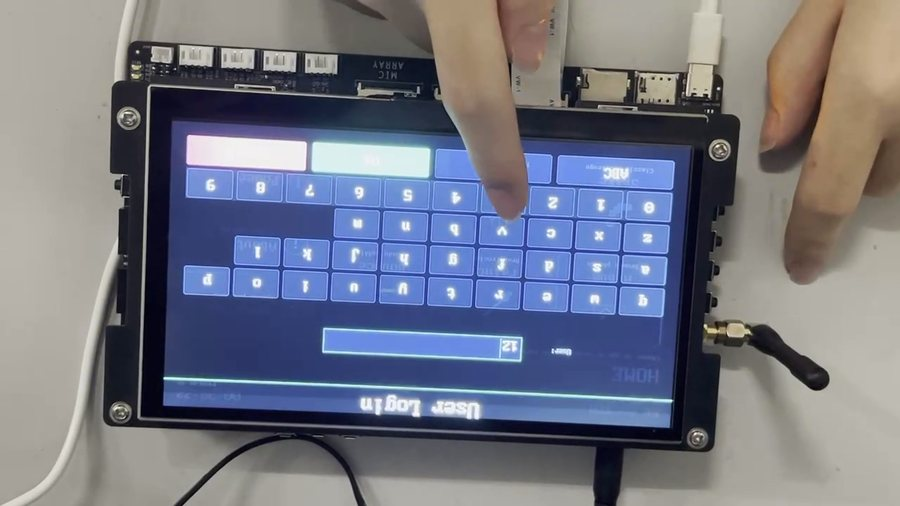
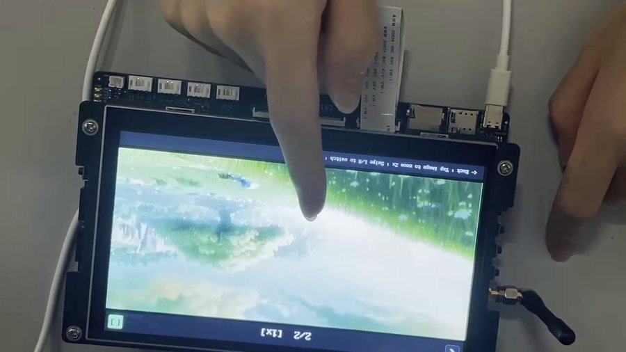
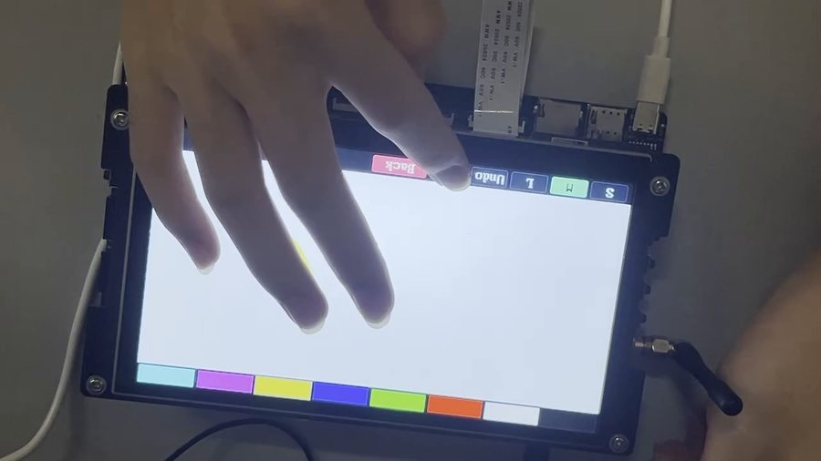
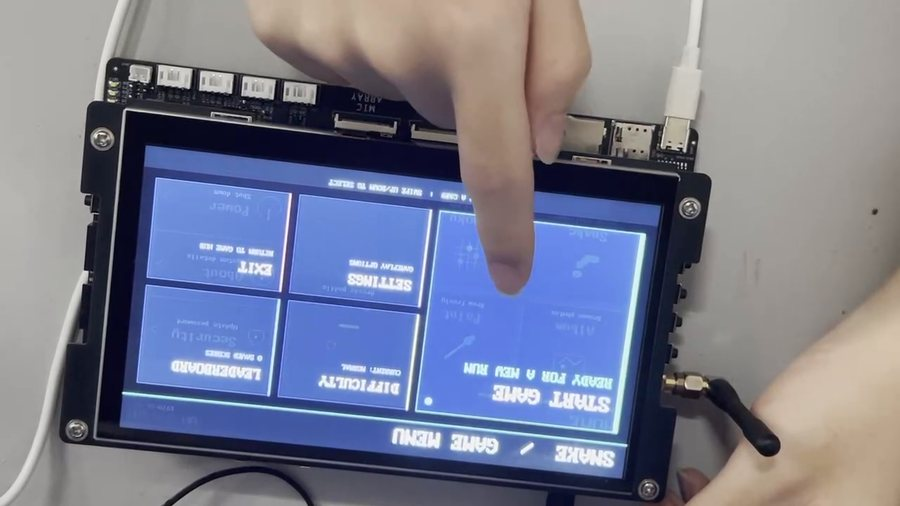

# RK3566 智能娱乐终端 · Linux Framebuffer 图形界面系统

基于瑞芯微 **RK3566** 平台、直接操作 Linux **Framebuffer**（`/dev/fb0`）与 **输入子系统**（`/dev/input/eventX`）实现的嵌入式触控图形界面系统。界面绘制、触摸事件解析、动画播放与游戏逻辑全部用 **C 语言**从零实现，不依赖 Qt / LVGL / SDL 等第三方 GUI 库。

> 本仓库是 **4 人小组的课程/实习项目**，不是个人项目。下面第二节先说明**本人**负责的模块，
> 其余模块由队友完成，列在第三节以便说明整体架构。
> 桂林电子科技大学 · 信息与通信学院 · 2026 年暑期生产实习项目（广州粤嵌通信科技股份有限公司承办）
> 团队成员：庞富文、滕忠玮、王重阳、杨沛鑫



---

## 一、硬件与运行环境

| 项 | 说明 |
|---|---|
| 主控 | 瑞芯微 RK3566（ARM64） |
| 显示 | 1024×600 LCD，通过 `/dev/fb0` 直接 mmap 映射显存 |
| 触摸 | Linux 输入子系统 `/dev/input/eventX`，解析 `input_event` 结构体 |
| 系统 | Ubuntu 18.04 开发环境 / ARM 开发板，aarch64 交叉编译 |
| 依赖 | 仅 libc + pthread；**无 Qt / LVGL / SDL** |
| 执行 | `sudo ./rk3566_gui`（需对 framebuffer 与 input 设备节点有读写权限） |

---

## 二、我负责的模块

本项目为 4 人小组协作，随项目提交的《小组成员文档》分工如下：

| 成员 | 负责内容 |
|---|---|
| 杨沛鑫 | 相册功能（缩略图、滑动上下张切换、放大缩小、退出）；账号密码登录；贪吃蛇游戏 |
| 庞富文 | 弹球游戏；整理文档 |
| **滕忠玮** | **五子棋游戏；开关机动画；触摸交互（输入子系统触摸事件处理与坐标映射）** |
| 王重阳 | 显示主界面；调试运行 |

> 上表前四项出自随项目提交的《小组成员文档》；「触摸交互」一项另据《生产实习报告》第（五）节小组分工原文：
> 「本人主要负责触摸交互与应用功能模块的开发，并参与整机联调、测试与项目文档整理。」

### 1. 五子棋（[`gomoku.c`](gomoku.c) / [`gomoku.h`](gomoku.h)）

- **15×15** 棋盘，双人本地轮流落子，黑先白后，点击棋盘交叉点落子
- 每次落子后自动进行 **横、竖、正斜、反斜四个方向的五连判定**，先连成五子者胜
- 顶部实时显示回合数与当前玩家；底部提供 `UNDO` 悔棋（记录上一步并可回退）、`NEW ROUND` 重新开局、`BACK` 返回菜单
- 边界处理：**点击棋盘外区域不落子**
- 对外接口：

  ```c
  int gomoku_run(void);
  ```



### 2. 开关机动画（[`boot_anim.c`](boot_anim.c) + [`animation.c`](animation.c)）

拆成「通用序列帧播放引擎 + 开/关机业务逻辑」两层，使动画能力可被其他界面复用：

- **动画引擎 `animation.c`**：按编号顺序加载 BMP 帧序列并逐帧显示，帧时长可配置（默认 50 ms），支持**循环 / 单次**两种播放模式；`animation_scan()` 在 `last_idx = -1` 时**自动扫描目录并推算最大帧号**，无需手工登记帧数；播放过程可通过传入的 `volatile int *interrupt` 标志从外部中断。全部配置封装在 `anim_opts_t` 中：

  ```c
  typedef struct {
      const char *dir;        /* 帧目录 */
      const char *prefix;     /* 文件名前缀, 如 "frame_" */
      const char *suffix;     /* 后缀, 如 ".bmp" */
      int  first_idx, last_idx;   /* 帧号范围, last_idx = -1 时自动扫描 */
      int  frame_ms;          /* 单帧时长(毫秒), 默认 50 */
      int  loop;              /* 是否循环播放 */
      int  fill_bg;           /* 是否先用背景色清屏 */
      unsigned int bg_color;
  } anim_opts_t;

  int animation_scan(anim_opts_t *opts);
  int animation_play(const anim_opts_t *opts, volatile int *interrupt);
  ```

- **开机动画 `boot_anim.c`**：以白屏为背景，将启动画面**从全白淡入到全彩**，持续约 **4 秒**；**触摸屏幕任意位置可跳过**，直接进入登录界面。帧文件位于 `res/boot/`。
- **关机动画**：全屏显示关机图片并**保持 5 秒**后返回，由调用方执行系统关机。帧文件位于 `res/shutdown/`。
- **降级策略**：资源缺失时不阻塞启动流程，退化为文字提示（`RK3566 Booting...` 等 2 秒 / `Shutting down...` 等 1 秒）后继续。
- 对外接口：

  ```c
  int boot_anim_play(const char *root, int frame_ms, int skip_on_touch);
  int shutdown_anim_play(const char *root, int frame_ms);
  ```




---

## 三、系统架构

| 层次 | 文件 | 职责 |
|---|---|---|
| 底层绘制 | [`ui.c`](ui.c) | Framebuffer mmap 映射；像素 / 矩形 / 圆 / 线 / 文字绘制；BMP 显示（支持区域绘制） |
| 输入处理 | [`input.c`](input.c) | 触摸事件解析（按下 / 移动 / 抬起）、手势识别（滑动、点击）、物理按键 |
| 应用框架 | [`app_ui.c`](app_ui.c) | 通用 UI 组件（卡片、图标、箭头） |
| 系统启动 | [`main.c`](main.c) | 初始化 → 开机动画 → 登录 → 主界面循环 |
| 开关机动画 | [`boot_anim.c`](boot_anim.c) / [`animation.c`](animation.c) | 开机淡入、关机保持、序列帧播放引擎 |
| 登录管理 | [`login.c`](login.c) | 虚拟键盘输入、账号密码验证、密码修改 |
| 主界面 | [`main_ui.c`](main_ui.c) | 主页网格布局，显示应用卡片与系统工具；3 页（多媒体 / 工具 / 游戏）左右滑动切换 |
| 相册 | [`album.c`](album.c) | 浏览目录下 BMP 图片，缩略图网格 + 单图查看 |
| 画板 | [`paint.c`](paint.c) | 8 色调色板、3 档笔刷粗细、撤销 / 清空、触摸绘画 |
| 游戏 | [`ball.c`](ball.c) / [`snake.c`](snake.c) / [`gomoku.c`](gomoku.c) | 板接球、贪吃蛇、五子棋 |
| 游戏框架 | [`game_menu.c`](game_menu.c) / [`game_ui.c`](game_ui.c) / [`touch_ctrl.c`](touch_ctrl.c) | 游戏入口菜单、公共 UI（侧边栏 / 计分板 / D-Pad）、半透明虚拟方向键 |

| | | |
|---|---|---|
|  |  |  |



演示视频见 [`demo/演示视频.mp4`](demo/演示视频.mp4)（1 分 10 秒，实机拍摄）。

---

## 四、编译

需要 ARM 交叉编译工具链（`aarch64-linux-gnu-` 或 `arm-linux-gnueabihf-`），要求支持 C99 与 pthread：

```bash
make CROSS_COMPILE=aarch64-linux-gnu-     # 交叉编译 ARM64
make                                       # 按本机架构编译（可在 x86_64 上做语法验证）
make help                                  # 目录结构 / 资源要求 / 降级行为
make debug                                 # -O0 -g3 -DDEBUG
make clean
```

不使用 Makefile 时，等价的手工编译命令为：

```bash
aarch64-linux-gnu-gcc -O2 -Wall -Wextra -std=gnu99 -D_GNU_SOURCE -I. -I./reference \
    main.c input.c ui.c app_ui.c animation.c boot_anim.c main_ui.c album.c login.c \
    paint.c ball.c snake.c gomoku.c game_menu.c game_ui.c touch_ctrl.c \
    ./reference/bmp_display.c -lpthread -o rk3566_gui
```

---

## 五、运行

```bash
sudo ./rk3566_gui
```

支持通过环境变量配置运行时参数：

| 环境变量 | 说明 | 默认值 |
|---|---|---|
| `RK_GUI_FB` | Framebuffer 设备路径 | `/dev/fb0` |
| `RK_GUI_INPUT` | 触摸输入设备路径 | `/dev/input/event6` |
| `RK_GUI_RES` | 资源根目录 | `./res` |
| `RK_SKIP_LOGIN` | 设为 `1` 跳过登录验证（调试用） | 未设置 |

运行时需要 `res/` 资源目录，**全部图片须为 24 位 BMP**：

```
res/
├── boot/           开机动画帧      frame_000.bmp, frame_001.bmp, ...
├── shutdown/       关机动画帧      frame_000.bmp, ...
└── album/          相册图片        任意命名的 .bmp
```

---

## 六、已知缺失

本仓库**不包含 `bmp_display.c` / `bmp_display.h`**。该模块是课程方提供的参考代码（BMP 文件解析与 LCD 基础接口），并非团队成员编写，也未随项目提交材料一同归档，因此直接 `make` 会在路径检查处报错并给出提示。接口清单见 [`reference/README.md`](reference/README.md)。

同样未包含：

- `res/` 资源图片（BMP 素材由实训环境提供，体积较大）
- 其他成员的模块说明文档

---

## 七、说明

[`ui.c`](ui.c) 中的绘图接口移植自课程参考代码 `bmp_display`，并扩展为支持区域绘制（见 `ui.h` 文件头注释）；[`animation.c`](animation.c)、[`boot_anim.c`](boot_anim.c)、[`gomoku.c`](gomoku.c) 及其余应用层模块均为团队成员自行实现。
